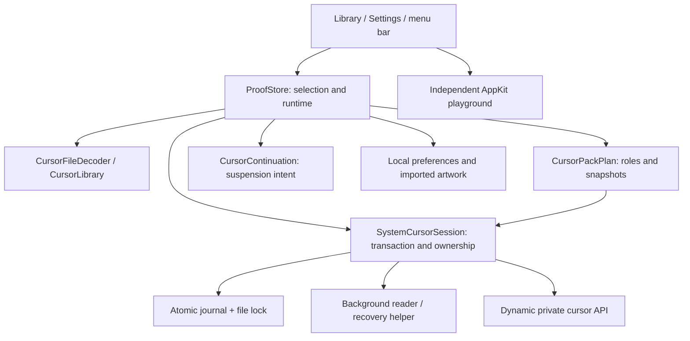

# Octapuss architecture

Current implementation, 16 October 2026. SwiftUI/AppKit macOS utility; no web runtime, network service, account, database, or third-party runtime dependency. Source remains in `Phase0/`; this directory name does not mean the app is still planning-only.

| Source | Responsibility |
| --- | --- |
| `Phase0/OctapussProof.swift` | Store, native preview/artwork, Settings, commands, app delegate/scenes |
| `Phase0/CursorLibraryView.swift` | Set library, gallery, role inspector, delete/Undo, action bar |
| `Phase0/CursorImport.swift` | Bounded CUR/ANI/native-theme parsing, normalized artwork, JSON library |
| `Phase0/CursorRoles.swift` | Conservative matching, overrides, conflicts, pack planning |
| `Phase0/SystemCursorBackend.swift` | API boundary, independent reads, verification, transactions/recovery, continuation |
| `OctapussTests/` | Isolated executable checks, view fixtures, helper and opt-in live recovery checks |

## Ownership and recovery

Selection is separate from the pack actually applied. SystemCursorSession serializes writes with a file lock and atomically saves every affected baseline first. A generation UUID prevents an old watchdog reverting a newer session. Restore verifies ownership, preserves external changes, and retains failed recovery ownership. Explicit Apply can archive an externally superseded journal without overwriting another utility's artwork.

The bundled OctapussCursorHelper.app has its own identifier and background-only policy. Short-lived readers avoid stale native API caches; a temporary pipe-watching helper restores an owned journal after a parent crash. It is neither privileged nor installed at login. Packaging is shared by the Command Line Tools builder and Xcode target.

## Lifecycle

Launch recovers unresolved registrations, then leaves system Apply explicit. Restore cancels resume work and pauses preview. Sleep, lock, or session deactivation restores owned registrations while remembering the exact applied snapshots in memory. Return waits for all suspension reasons to clear, then uses a cancellable delay before reapplication. macOS controls protected lock-screen appearance.

Dock Quit and ⌘Q cancel ordinary termination, hide windows, and switch to accessory activation. Reopening restores regular activation. Menu-bar Quit and system logout/restart/shutdown restore before exiting; failed restoration exposes the error and cancels normal exit. Crashes use the watchdog. There is no startup/reboot persistence, pointer hiding, event tap, overlay, or activity monitoring.

## Preview and persistence

The AppKit preview owns cursor rectangles, scaled hotspots, tracking areas, and a native click-test button. Local animation retains its sequence. Its timer runs only for an enabled, visible key-window preview with Reduce Motion off; hiding, inactivity, occlusion, Restore, and detachment stop it. Native playback is handled by macOS with at most 24 uniform steps.

Preferences retain selection, size, and background; runtime activation and clicks do not resume on launch. Imported normalized artwork and role overrides are stored locally. Unambiguous matching-folder imports preserve IDs/assignments. Pack deletion preserves downloads and the applied effect; one-level Undo lasts for the current process.

## Compatibility and distribution

Deployment target: macOS 14. Verified support is limited to configurations in [STABILITY_REPORT.md](STABILITY_REPORT.md). The private API backend is experimental and intended for direct distribution rather than an App Store claim. Full Xcode, signing/notarization, and additional OS/hardware combinations are separate gates. The app requests no global input or screen-capture permission and records no pointer history, typing, screenshots, clicked content, or app activity.
