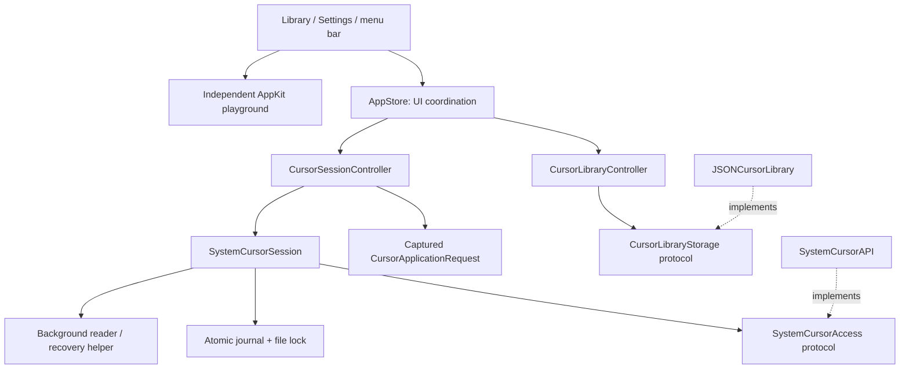

# Octapuss architecture

Current implementation, 16 October 2026. Native SwiftUI/AppKit macOS utility, with one application target and no third-party runtime dependencies. Production source lives in `Octapuss/`; `Phase0/` has been retired. The existing builder name remains compatible with local workflows.

## Source ownership

| Directory | Responsibility |
| --- | --- |
| `Octapuss/App/` | Entry point, helper-mode dispatch, scenes, commands, Dock/menu-bar and macOS lifecycle integration |
| `Octapuss/Application/` | UI coordination, library edits, Apply/cancel/resume workflows, captured requests, storage and native-access interfaces |
| `Octapuss/Models/` | Foundation-only cursor data, roles, filenames, sizes, snapshots and suspension intent |
| `Octapuss/Features/` | SwiftUI library, Settings, preview bridge and shared visual components |
| `Octapuss/Platform/Import/` | Native import panel, bounded CUR/ANI/theme decoding and AppKit image conversion |
| `Octapuss/Platform/Preview/` | Native playground view, cursor rectangles, animation timer and native cursor samples |
| `Octapuss/Platform/SystemCursor/` | macOS slot aliases, pack snapshot assembly, dynamic ABI access, verification, serialized transactions and helper runtime |
| `Octapuss/Persistence/` | Typed preferences, application-support paths, validated JSON artwork storage and durable journal schema |
| `Octapuss/Resources/` | Main app and background-helper bundle metadata |
| `OctapussTests/` | Isolated executable checks, view fixtures, helper checks and opt-in native recovery checks |

## State and dependency rules

- **One owner per responsibility.** The library controller owns imported items, selection, role edits and deletion/Undo. The cursor controller owns the applied effect, in-flight work, cancellation, recovery and suspension intent. AppStore owns presentation preferences, clicks and the latest diagnostic; it forwards controller changes to SwiftUI rather than copying their state.
- **Capture intent before async work.** CursorApplicationRequest is an immutable value. Selection, pack or size changes after Apply cannot replace its snapshots, loading artwork or applied label.
- **Persist before publishing.** Library edits save through CursorLibraryStorage before replacing the in-memory collection. A failed save leaves selection and deletion recovery intact. A failed initial load leaves storage unavailable to prevent replacing the saved library with an empty one.
- **Use narrow interfaces at side effects.** JSONCursorLibrary implements CursorLibraryStorage; SystemCursorAPI implements SystemCursorAccess. Tests inject memory storage and a fake registry. Additional interfaces should follow a concrete need rather than wrap every value or function.
- **Keep platform rendering out of models.** ImportedCursor and CursorSnapshot retain their existing Codable schemas. AppKit images, PNG normalization, cursor construction, native animation sampling and pixel comparison live in platform extensions. Foundation-only models can be typechecked on their own.
- **Keep views out of persistence and native writes.** Views issue AppStore commands. Native file selection belongs to CursorImportPanel, parsing to CursorFileDecoder, and registry operations to the backend.
- **Preserve concurrency ownership.** UI and controller state is main-actor isolated. SystemCursorSession is marked unchecked Sendable because its instance mutations are confined to its serial operations queue; do not access its mutable API/helper state outside that queue.
- **Keep preview independent.** The playground remains usable without activating the native backend. Its pointer ownership is bounded to the visible portion of its actual bounds.

These are source boundaries within one target, not independently packaged modules. Native preparation still uses concrete platform services where there is one implementation. There is no dependency container framework, network layer, generic repository hierarchy or speculative plugin system.

## Extending the app

| Change | Start here | Relevant proof |
| --- | --- | --- |
| Import format | Platform/Import/CursorFileDecoder.swift | CursorImportChecks |
| Cursor role or native alias | Models/CursorRole.swift and Platform/SystemCursor/CursorRole+SystemSlots.swift | CursorPackChecks |
| Library edit or storage implementation | Application/CursorLibraryController.swift and CursorLibraryStorage | Injected-storage and deletion/Undo checks |
| Apply, cancellation or suspension | Application/CursorSessionController.swift | Blocking-registry lifecycle and continuation checks |
| Recovery ownership or private API | Platform/SystemCursor/SystemCursorSession.swift and SystemCursorAPI.swift | Transaction tests, then authorized live recovery check |
| Preview behavior | Platform/Preview/CursorPreviewNSView.swift | Boundary, animation, hit-test and render checks |
| Visual layout | Features/Library or Features/Settings | Offscreen fixtures and native accessibility checks |

Add each new Swift file to the Xcode target. The Command Line Tools builder discovers production Swift files recursively; `python3 scripts/check-architecture.py` checks that Xcode compiles the same files exactly once, along with basic dependency rules and executable metadata. CI runs this gate before Xcode compilation. Do not add test entry points to the production source tree.

## Ownership and recovery

Selection is separate from the pack actually applied. SystemCursorSession serializes writes with a file lock and atomically saves every affected baseline first. A generation UUID prevents an old watchdog reverting a newer session. Restore verifies ownership, preserves external changes, and retains failed recovery ownership. Explicit Apply can archive an externally superseded journal without overwriting another utility's artwork.

Apply preparation runs away from the UI thread, and session instance operations share a private serial queue. The main actor publishes loading artwork/status and handles cancellation; it cannot mark a cancelled operation applied after its worker returns. Deferred Quit waits for restoration. See [Apply feedback and cancellation](APPLY_PROGRESS.md).

The bundled OctapussCursorHelper.app has its own identifier and background-only policy. Short-lived readers avoid stale native API caches; a temporary pipe-watching helper restores an owned journal after a parent crash. It is neither privileged nor installed at login. Packaging is shared by the Command Line Tools builder and Xcode target.

## Lifecycle

Launch recovers unresolved registrations, then leaves system Apply explicit. Restore cancels resume work and pauses preview. Sleep, lock, or session deactivation restores owned registrations while remembering the exact applied snapshots in memory. Return waits for all suspension reasons to clear, then uses a cancellable delay before reapplication. macOS controls protected lock-screen appearance.

Dock Quit and ⌘Q cancel ordinary termination, hide windows, and switch to accessory activation. Reopening restores regular activation. Menu-bar Quit and system logout/restart/shutdown restore before exiting; failed restoration exposes the error and cancels normal exit. Crashes use the watchdog. There is no startup/reboot persistence, pointer hiding, event tap, overlay, or activity monitoring.

## Preview and persistence

The AppKit preview owns cursor rectangles, scaled hotspots, tracking areas, and a native click-test button. Local animation retains its sequence. Its timer runs only for an enabled, visible key-window preview with Reduce Motion off; hiding, inactivity, occlusion, Restore, and detachment stop it. Native playback is handled by macOS with at most 24 uniform steps.

Preferences retain selection, size, and background; runtime activation and clicks do not resume on launch. Imported normalized artwork and role overrides are stored locally. Unambiguous matching-folder imports preserve IDs/assignments. Pack deletion preserves downloads and the applied effect; one-level Undo lasts for the current process.

## Compatibility and distribution

Deployment target: macOS 14. Verified support is limited to configurations in [STABILITY_REPORT.md](STABILITY_REPORT.md). The private API backend is experimental and intended for direct distribution rather than an App Store claim. Full Xcode, signing/notarization, and additional OS/hardware combinations are separate gates. The app requests no global input or screen-capture permission and records no pointer history, typing, screenshots, clicked content, or app activity.
