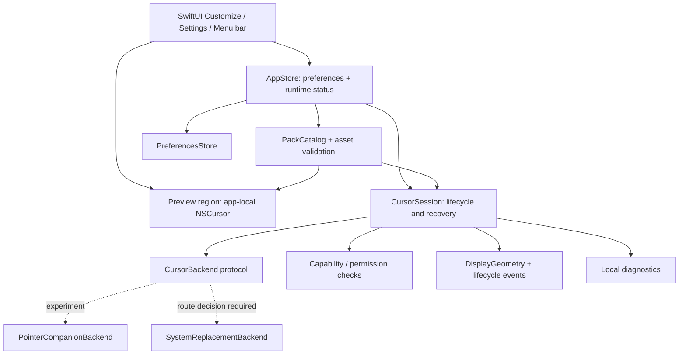
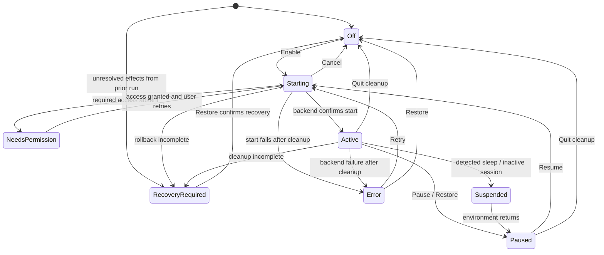

# Octapuss architecture proposal

## Stack and boundaries

Use **Swift + SwiftUI** for the app and Settings, **AppKit** for preview cursor regions and any experimental overlay windows, and **CoreGraphics only where the chosen backend needs it**. Use an Xcode macOS app target with focused unit tests. Prefer system frameworks; no backend server, web runtime, database, third-party analytics, or framework dependencies are required for the first release.

SwiftUI supports composing a main window with a persistent menu-bar control. This matches Octapuss's window-plus-utility design. [Apple's menu-bar scene explanation](https://developer.apple.com/videos/play/wwdc2022/10061/).

Propose macOS 14+ as a starting deployment target, then narrow or raise it according to the actual test matrix. Compile the proof against the active SDK and avoid newer APIs without availability checks. Architecture support is not evidence that an OS version has been tested.

Keep one application target and feature folders initially. Small protocols provide the boundaries that need substitutes in tests; a separate package or helper process is unnecessary until the cursor route demonstrates a need.

## Components



The preview runs independently of any global backend and needs no global monitoring. It must remain usable when permission is denied or no system-wide implementation exists.

| Component | Responsibility |
| --- | --- |
| AppStore | Main-thread observable state shared by window, Settings, and menu bar |
| PackCatalog | Load bundled manifests; validate dimensions, asset paths, alpha, and hotspot |
| PreviewRegion | Use an AppKit view/cursor rectangle to test a pack inside Octapuss |
| CursorSession | Sole owner of start, stop, cancellation, suspension, and cleanup |
| CursorBackend | Declare scope/capabilities and implement start, update, stop |
| PointerCompanionBackend | Experimental click-through decoration, with native cursor visible |
| SystemReplacementBackend | Future implementation only after route selection and proof |
| PointerTrackingService | Observe only the pointer movement needed by a selected overlay route |
| PermissionService | Check/request only capabilities used by the chosen backend |
| DisplayGeometry | Normalize screen positions, backing scales, and display changes |
| PreferencesStore | Typed UserDefaults settings with schema version and safe defaults |
| Diagnostics | Local OS/backend/error metadata; no pointer history or input content |

Do not build an overlay, event tap, or helper merely because the abstraction exists. A replacement backend may use a different mechanism and should not inherit overlay assumptions.

## Backend contract

Express these responsibilities in a small protocol; exact Swift signatures belong to implementation:

- Report capabilities: app-local preview, companion, or system replacement; required permissions; tested restrictions.
- Start with a validated pointer selection and return an actual running state or a typed failure.
- Update an active selection transactionally.
- Stop idempotently and return a cleanup outcome: fully restored, or incomplete with remaining owned resources and recovery instructions.
- Report detected failure or suspension through one event channel.

`supportsSystemReplacement` is evidence-backed capability, not a switch that makes an overlay a replacement. Return meaningful errors such as permission missing, tracking unavailable, invalid asset, unsupported environment, and cursor restoration failure.

On incomplete cleanup, retain ownership of remaining effects and baseline data; release ownership only when cleanup is confirmed. Block a new start until recovery resolves. The independent preview owns its app-local cursor region and restores that region's normal state when it is removed; global Restore deliberately keeps preview functionality available.

## State and lifecycle



`selectedPack` and `selectedSize` are preferences. `runtimeState` and `activeScope` come from the session. Persist preferences, not a blind instruction to restart effects. Launch begins Off when no unresolved effects remain; if a backend can leave changes after exit, check its recovery record first and show RecoveryRequired when restoration is unconfirmed. Never automatically reactivate customization after an unexpected exit. After sleep/session return, require Resume for the first beta rather than immediately hiding anything again.

All transitions to Off, Paused, Suspended, or a stopped Error require successful cleanup. The diagram shows the primary paths; Restore is available from Starting, NeedsPermission, Active, Paused, Suspended, Error, and RecoveryRequired. It cancels pending work, attempts idempotent cleanup, and ends in Off/Paused only on success. A failed attempt remains RecoveryRequired. Suspend uses the same cleanup outcome rather than assuming a lifecycle notification means restoration succeeded.

Quit cancels pending work and attempts cleanup from every state, including the preview. If restoration fails, show the remaining effect and concrete recovery instructions with Retry Restore and an explicit Quit anyway action. Do not hide failure behind a successful shutdown status. A backend with persistent cursor changes must save the recovery baseline before applying them, so a later launch or external recovery can use it.

Make start/stop operations serialized. Associate asynchronous callbacks with a session generation so a cancelled start cannot re-enable the effect. Attach cleanup ownership to successful resource creation. If any later start step fails, unwind resources already created.

Recovery removes monitors/taps, destroys overlays, and reverses only cursor changes owned by Octapuss. For a hide-based experiment, match each successful hide with one show; do not call Show repeatedly to override other apps' state. Forced termination bypasses normal cleanup, so passing crash recovery requires real testing, not a `deinit` assumption. [Cursor hide/show behavior and caveats](FEASIBILITY.md).

A future private replacement backend may change state beyond the process lifetime. It needs a durable captured baseline and tested external recovery strategy; do not assume app exit restores those changes. Any helper must be justified by evidence and get its own lifecycle tests.

## Pointer and settings data

Bundled pack metadata, proposed:

| Field | Meaning |
| --- | --- |
| schemaVersion | Manifest format, beginning with 1 |
| id / displayName | Stable identifier and readable name |
| variant | Ink, Tide, or Blush |
| logicalCanvasSize | Width/height in points at reference size |
| hotspot | x/y in the same logical coordinate system |
| assetRepresentations | Bundled transparent images and scale metadata |
| supportedRoles | Arrow only initially; never imply a full cursor set |

Validate finite positive dimensions, hotspot inside the canvas, image representations, and a valid bundled path before enabling. If the artwork scales by factor `s`, render size and hotspot both scale by `s`. Preserve explicit coordinate-origin semantics in asset tooling.

Preferences: schema version, selected pack ID, size preset, and appearance (`system`, `light`, `dark`). Unknown pack IDs or corrupted values fall back to Ink and Medium. Save current valid preferences when changed; engine errors do not destroy them. Import parsing and custom user assets are deferred.

## Coordinate and rendering discipline

If an overlay route is selected, use AppKit global screen points internally. Keep any Quartz conversion at one boundary and verify it on displays positioned left of and above the primary screen. Do not flip using whichever display happens to be active. Represent negative coordinates correctly.

Hotspots are in logical points; backing conversions handle pixel resolution per display. Recompute geometry when screens change. A global Retina multiplier is insufficient for mixed-scale displays. See [coordinate sources](FEASIBILITY.md#coordinates-and-lifecycle).

For an overlay, choose small click-through windows or bounded layers from the experiment results. Coalesce pointer events to the latest position; avoid expensive SwiftUI layout per movement and stop work entirely when inactive. If display-linked scheduling or window updates introduce visible lag, change the rendering approach before adding smoothing. Do not install a permanent high-frequency timer by default.

Actual cursor-role behavior is a gate. There is no established public global semantic-cursor notification in this research. Do not guess I-beam/link/resize state from other apps or add screen capture just for appearance detection.

## Privacy, permissions, and distribution

The app-local preview requests no global input permission. An overlay proof first tests mouse-only observation with minimal access. A listen-only event tap may need Input Monitoring; exact needs must be established for the selected event mask. Do not request Accessibility or Screen Recording by default. Public passive monitoring is not automatically incompatible with App Sandbox. [Apple permission guidance](FEASIBILITY.md#permissions).

Do not record movement, clicked content, text, screenshots, or application activity for diagnostics. Use local structured errors and opt-in export only if later required.

For the beta, prepare a normal local app. For external direct distribution, plan Developer ID signing, hardened runtime and notarization after choosing the backend. Do not disable App Sandbox solely on assumptions about monitoring. A private-API cursor backend is a separate technical and distribution decision; it cannot be presented as eligible for Mac App Store review under the public-API requirement. [Apple App Review guideline 2.5.1](https://developer.apple.com/app-store/review/guidelines/).

## Proposed source layout, created later

```text
Octapuss.xcodeproj
Octapuss/
  App/             App entry, shared store, commands, menu bar
  Features/        Customize, Settings, Onboarding
  Cursor/          Preview, session, backend contracts, selected backend
  Platform/        Permissions, displays, tracking, lifecycle
  Models/          Pack metadata, selection, typed errors
  Persistence/     PreferencesStore
  Resources/       Bundled pack manifests and asset catalog
OctapussTests/     Geometry, validation, state, recovery ownership
```

This tree is a proposal; none of these app files exists yet.
